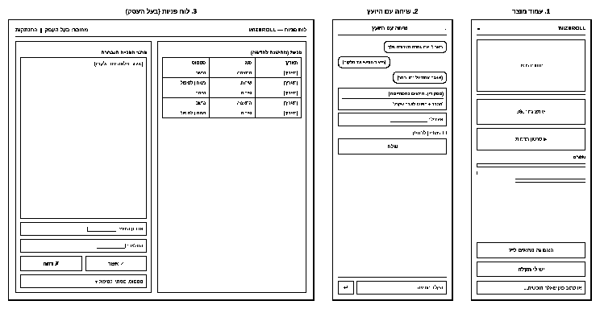
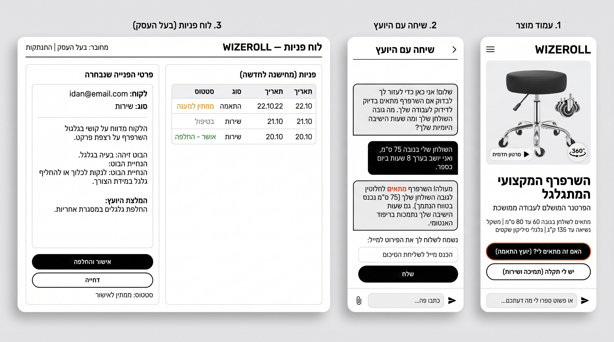
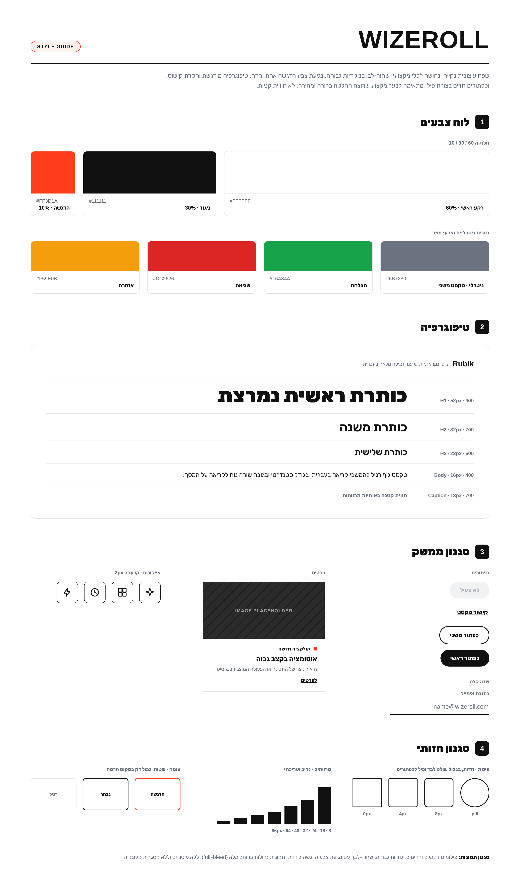

# DESIGN: WIZEROLL

## תמונות הייחוס

## 1. Screens

### עמוד מוצר
- המטרה: להציג את השרפרף ולהוביל את הלקוח לאחד משני מסלולי היועץ.
- מה יש במסך: סרגל עליון עם תפריט המבורגר ולוגו `WIZEROLL`; תמונת מוצר ראשית עם כפתור סרטון תדמית ותג תצוגת 360 מעלות; כותרת המוצר ("השרפרף המקצועי המתגלגל") ותיאור קצר עם נתוני מפרט עיקריים (טווח גובה שולחן, משקל נשיאה, סוג גלגלים); שני כפתורי כניסה ליועץ - כפתור ראשי מודגש "האם זה מתאים לי? (יועץ התאמה)", וכפתור משני "יש לי תקלה (תמיכה ושירות)"; שדה טקסט חופשי בתחתית המסך.
- מה קורה במסך: לחיצה על אחד משני הכפתורים פותחת את מסך השיחה עם היועץ במסלול המתאים. כתיבה חופשית בשדה התחתון, בלי בחירת מסלול, מעבירה גם היא למסך השיחה, ושם היועץ שואל שאלה אחת - "זה לפני קנייה או אחריה?" - אם הכוונה לא ברורה.

### שיחה עם היועץ
- המטרה: לנהל את שני מסלולי היועץ, התאמה ושירות, באותו מסך שיחה.
- מה יש במסך: כותרת עליונה "שיחה עם היועץ" עם חץ חזרה לעמוד המוצר; בועות שיחה - הודעות היועץ ברקע בהיר מימין, הודעות הלקוח ברקע כהה משמאל; הדגשת מילת המפתח בפסק הדין (כגון "מתאים") בצבע ההדגשה; שדה טקסט תחתון עם כפתור צירוף קובץ וכפתור שליחה.
- מה קורה במסך: הלקוח מתאר את עמדת העבודה שלו או את התקלה, היועץ שואל שאלה אחת על נתון חסר בכל פעם, ובסיום מחזיר פסק דין מנומק (במסלול ההתאמה) או הנחיית תיקון (במסלול השירות), ומציע לשלוח את התשובה למייל.

### לוח פניות (בעל העסק)
- המטרה: לאפשר לבעל העסק לראות את כל הפניות הפתוחות ולאשר או לדחות פעולה שעולה כסף.
- מה יש במסך: כותרת "לוח פניות - WIZEROLL" עם מחוון "מחובר: בעל העסק" וקישור התנתקות; טבלת פניות עם עמודות תאריך, סוג וסטטוס (ממתין למענה, בטיפול, אושר-החלפה), מהחדשה לישנה; פאנל פרטי פנייה נבחרת מימין - לקוח, סוג, תיאור, המלצת היועץ; שני כפתורי פעולה, "אישור והחלפה" (ראשי) ו"דחייה" (משני).
- מה קורה במסך: בעל העסק בוחר פנייה מהרשימה, קורא את הפרטים ואת המלצת היועץ, ומאשר או דוחה את הפעולה המוצעת. הלקוח מקבל מייל עם ההחלטה.

### ניווט בין המסכים
מעמוד המוצר, שני הכפתורים (וגם שדה הטקסט החופשי) מובילים למסך השיחה עם היועץ; חץ החזרה בכותרת השיחה מחזיר לעמוד המוצר. לוח הפניות הוא אזור נפרד המיועד לבעל העסק בלבד, הדורש התחברות בנפרד - הלקוח לא מגיע אליו מעמוד המוצר או ממסך השיחה.

## 2. Style Guide

### צבעים
60% רקע לבן `#FFFFFF`, 30% שחור `#111111` לטקסט ולניגוד, 10% כתום-אדום `#FF3D1A` כצבע הדגשה לפעולה עיקרית ולמילות מפתח. גוונים ניטרליים וצבעי מצב: אזהרה `#F59E0B`, שגיאה `#DC2626`, הצלחה `#16A34A`, ניטרלי משני `#6B7280`.

### גופנים
`Rubik`, עם תמיכה מלאה בעברית. כותרת ראשית H1 52px/900, H2 32px/700, H3 22px/600, טקסט רץ 16px/400, כיתוב קטן (Caption) 13px/700.

### כפתורים ורכיבים
כפתור ראשי: רקע שחור מלא, טקסט לבן. כפתור משני: מתאר (outline) שחור על רקע לבן. שדה קלט: קו תחתון בלבד, בלי מסגרת מלאה. כרטיסים: תמונה כהה בחלק העליון ותוכן לבן מתחתיה. אייקונים: קו דק ברוחב 2px.

### פינות, צורות ומרווחים
פינות בארבע מידות: 0, 4, 8px ו-pill (עגול מלא, לכפתורים ולתגיות). צללים עדינים ולא בולטים. מרווחים נדיבים ואוורריים בין רכיבים.

### אווירה כללית
מינימליסטית, שחור-לבן עם נגיעת הדגשה כתומה-אדומה אחת. תמונות דינמיות וחדות ברוחב מלא (full-bleed), בלי עיטורים או מסגרות מסורבלות.
